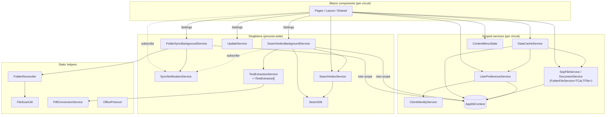
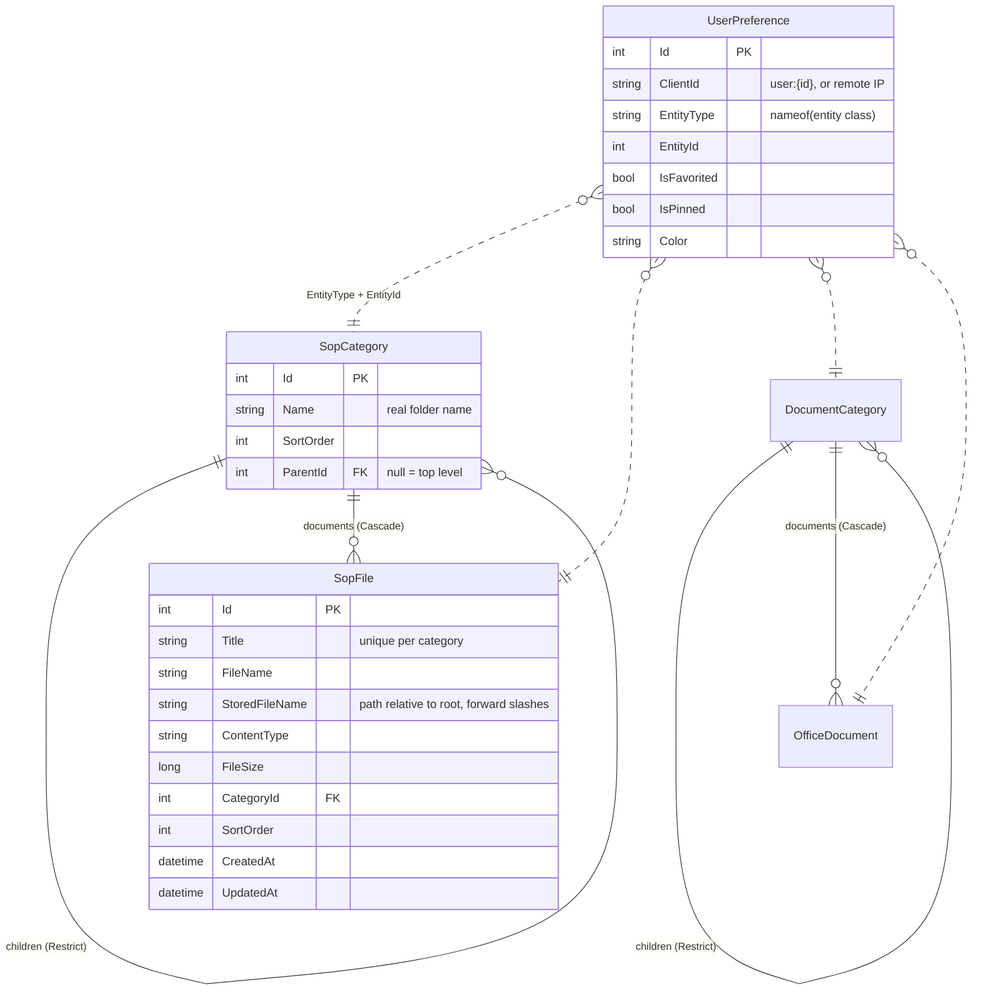
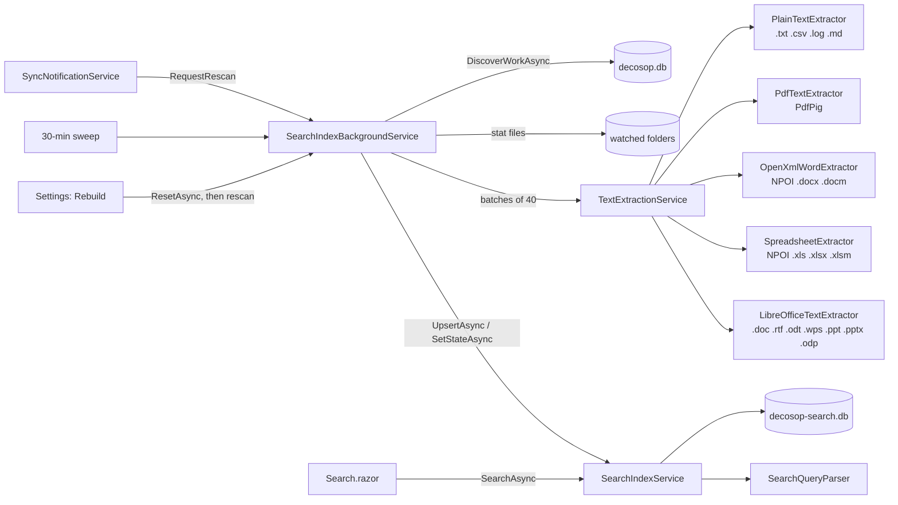

# Code architecture

This document describes how the DecoSOP codebase is organised and why. It covers the
deployed system only where the code depends on it. For that, see
[system-architecture.md](system-architecture.md).

## Repository layout

```
Program.cs                  Host setup, DI registration, minimal-API file endpoints, CLI mode
DecoSOP.csproj              Single web project (net10.0, self-contained win-x64)
Components/
  App.razor, Routes.razor   Root document; everything renders InteractiveServer
  Layout/                   MainLayout, NavMenu (sidebar + search box), ReconnectModal
  Pages/                    FileHome, CategoryView, FileViewer, FileUpload, Favorites,
                            Search, Settings, Error, NotFound
  Shared/                   CategoryContextMenu, UpdateBanner, icons, skeleton loaders
Data/
  AppDbContext.cs           EF Core model for decosop.db
  SqlitePragmaInterceptor   busy_timeout on every EF connection
  SearchDb.cs               Raw ADO.NET owner of decosop-search.db (FTS5)
Models/                     SopCategory/SopFile, DocumentCategory/OfficeDocument,
                            UserPreference, and the shared IFolderEntities interfaces
Services/
  FolderFileService.cs      Generic folder-backed CRUD (SopFileService/DocumentService close it)
  FolderReconciler.cs       Disk → DB reconciliation algorithm
  FolderSyncBackgroundService.cs   Watchers, debounce, periodic rescan
  SyncNotificationService   In-process pub/sub: "a module changed"
  DataCacheService          Per-circuit cache + DbContext serialisation
  UserPreferenceService     Favorites / pins / colours keyed by client IP
  PdfConversionService      LibreOffice → PDF preview cache
  OfficeProtocol            ms-word:/ms-excel:/ms-powerpoint: link builder
  UpdateService             GitHub release check + self-update
  Extraction/               ITextExtractor implementations + dispatcher + extract-report CLI
  Search/                   Index writer/reader, query parser, background indexer
wwwroot/js/                 Small JS interop: PDF preview/print, context menu, sidebar resize
tests/DecoSOP.Tests/        xUnit tests (query parser, SearchDb rowids, text normaliser)
installer/                  Inno Setup script + Configure-DecoSOP-Sync.ps1
```

## Layering

This is a layered single project, not Clean Architecture: there are no separate Domain,
Application and Infrastructure projects, services use EF Core directly rather than through
repository interfaces, and `Models/` are the EF entities. At this size that's deliberate. What
keeps it maintainable is that dependencies flow one way, held by these rules:

- **Components talk to services, never to a `DbContext`, `SearchDb` or the file system.**
  Database work a page needs belongs in a service (for example, Settings uses
  `DatabaseMaintenanceService` for stats and restore).
- **`Services/`, `Data/` and `Models/` never reference the UI.** They don't use `IJSRuntime`,
  `NavigationManager` or components. UI-only state that needs JS, such as `LayoutState` for the
  menu pin and open list, lives in `Components/Layout/`.
- **Services raise events and components subscribe.** For example, `UserListService.Changed`
  and `DataCacheService.FavoritesChanged`. Components marshal back onto the circuit with
  `InvokeAsync`.

The flow:



**Lifetimes matter here.** Blazor Server gives each browser tab (circuit) its own DI scope, so
scoped services, including `AppDbContext`, live as long as the tab. Background services are
singletons and must create their own scope (`IServiceScopeFactory`) for each unit of database
work. Never inject a scoped service into a singleton.

## Startup (`Program.cs`)

1. **CLI mode:** `DecoSOP.exe extract-report …` runs `ExtractionReport.RunAsync` and exits
   without building the web host.
2. Configure the Windows Service host, read the port from `port.config` (default 5098), and
   bind to `0.0.0.0`.
3. Choose the **data directory**: the content root in Development, otherwise
   `AppContext.BaseDirectory`. Paths for `decosop.db` and `decosop-search.db` are built from it.
4. Read `FolderSync` and push the roots and `OpenBase` into the **static** properties of
   `SopFileService` and `DocumentService` (see [Module configuration via generic statics](#module-configuration-via-generic-statics)).
5. Register services (lifetimes as in the diagram above). Background services are registered
   as singletons *and* as hosted services via the same instance, so the Settings page can inject
   them to read status and trigger actions.
6. `SchemaUpgrader.EnsureTablesAsync` the main and ONLINE databases, then switch them to WAL
   once (WAL persists in the file header). The upgrader is `EnsureCreated` plus EF's create
   script rerun with `IF NOT EXISTS`, so tables added in a later version (users, lists) appear
   on existing installs. It only adds whole tables and indexes; a new column on an existing
   table still needs its own upgrade step.
7. Map Razor components, then the file API, once per module, through the local `MapFileApi<TFile>`
   generic, plus `/api/settings/export-db`.

## Data model

### Main catalog — `decosop.db` (EF Core, `AppDbContext`)



- The **SOP** and **Document** modules have identical but separate tables. They share
  behaviour through the interfaces in `Models/IFolderEntities.cs` (`ICategoryNode<TCat,TFile>`,
  `IFileNode<TCat>`), and generic code is written against those interfaces.
- `StoredFileName` is the join key to disk. It's the file's path relative to the module root,
  for example `Billing/Insurance/EOB process.docx`. Files in the root folder land in a synthetic
  top-level category named **General**, which has no folder of its own.
- Unique indexes: `(ParentId, Name)` on categories, `(CategoryId, Title)` on files, and
  `(ClientId, EntityType, EntityId)` on preferences.
- `UserPreference` is polymorphic by `EntityType` string (`nameof(SopCategory)` etc.) with no
  FK. The reconciler cleans up orphaned rows when it removes files or categories.
- **Users and lists:**
  - **`AppUser`** is a person in the office. There's no login; people pick their name in the
    header. `ClientIdentityService` reads the `decosop-user` cookie. When a user is chosen, the
    preference key (`ClientId`) is `user:{id}`, so favorites, pins, colours and lists follow the
    person to any PC. With no user chosen it falls back to the PC's IP, as before. A newly added
    user starts with a copy of that PC's setup.
  - **`UserList` / `UserListItem`** hold "To Review" (built in, one per owner) and custom lists.
    They're keyed by the same `OwnerKey`/`ClientId` and point at
    `SopFile`/`OfficeDocument`/`SopCategory`/`DocumentCategory`/`OnlinePage` by type name and
    id (`ListEntity`), with no FK, because ONLINE pages live in another database.
  - **Favorites** isn't a `UserList`: it's the existing `UserPreference.IsFavorited` star,
    which `UserListService` presents as a list.
- The schema is created by `SchemaUpgrader` (see Startup); **there are no EF migrations**. New
  tables are added on upgrade, but a change to an existing table won't be applied to existing
  installs, so it needs its own upgrade path.

### Search index — `decosop-search.db` (raw `Microsoft.Data.Sqlite`, `SearchDb`)

Kept in a separate file on purpose, for four reasons: it's derived data that shouldn't bloat the
DB export; deleting it is a complete repair; a long build shouldn't compete with the main
database's single writer; and FTS5 virtual tables don't fit EF's model.

| Table | Purpose |
|---|---|
| `SearchIndex` (FTS5) | `Module`, `FileId`, `Ext` (UNINDEXED, so filters and links need no join) + `Title`, `CategoryPath`, `FileName`, `Body`. Tokeniser `unicode61 remove_diacritics 2`, prefix indexes 2/3/4, **no stemmer**. |
| `IndexState` | One row per `(Module, FileId)`: source mtime + size fingerprint, extractor used, status (`pending`, `ok`, `empty`, `failed`, `skipped`, `missing`), attempt count, error text. Drives incremental indexing, resume-after-restart and the Settings panel. |

- **Rowids are computed, not stored:** `RowIdFor(module, fileId) = fileId * 2 + (Doc ? 1 : 0)`.
  This lets a file's row be replaced or deleted without a lookup. Never renumber the module
  ordinals.
- **Schema versioning:** `PRAGMA user_version` holds `SchemaVersion`. If it doesn't match, both
  tables are dropped and rebuilt. Bump `SchemaVersion` whenever the schema or tokeniser changes.
  Never write a migration for this database.

## Folder sync engine

### `FolderFileService<TCat, TFile>` — UI-initiated changes

Generic service closed as `SopFileService` and `DocumentService` (each a one-line subclass).
It holds every folder-backed operation: tree loading, create/rename category, upload, replace
and path helpers. In each operation the **disk change happens first** and the DB row follows,
with compensation on failure (an upload deletes the file it wrote if the DB save fails).

| Operation | Disk effect | DB effect |
|---|---|---|
| `CreateCategoryAsync` | `Directory.CreateDirectory` | insert category |
| `RenameCategoryAsync` | `Directory.Move` (refuses if the target exists; refuses on General) | rename + rewrite `StoredFileName` prefixes of descendant files |
| `UploadDocumentAsync` | write into the category folder, `name (2).ext` on collision, 50 MB cap | insert file |
| `ReplaceFileAsync` | write `*.uploadtmp`, then atomic `File.Move(overwrite)`; same extension required | update size/UpdatedAt |
| *(delete)* | **not offered** — users delete on disk | reconciler removes rows |

### Module configuration via generic statics

`SyncRoot`, `OpenBase`, `DataDirectory` and `FallbackDirName` are **static properties on the
generic class**. Statics are per closed generic type, so `FolderFileService<SopCategory,SopFile>`
and `FolderFileService<DocumentCategory,OfficeDocument>` each hold their own values. They're set
once in `Program.cs`. `GetUploadDirectory()` returns the configured root if it exists, otherwise
the fallback `sop-uploads/` or `doc-uploads/` under the data directory. Static callers
(the file API, the search indexer, `PdfConversionService`) use these without needing a scope.

### `FolderReconciler` — disk → DB

A static, idempotent, non-destructive algorithm run inside one transaction per module:

1. **Scan** the root recursively (`FileScanUtil.WalkFiles`), skipping `~$` Office lock files.
   It only reads `FileInfo` metadata (size, mtime), never contents, so OneDrive placeholders
   aren't hydrated. Files that can't be read are skipped and picked up on the next pass.
2. **Load** all category and file rows for the module.
3. **Partition** by `StoredFileName` into matched, new-on-disk and vanished.
4. **Detect moves/renames:** a vanished row with *exactly one* new file of the same size and
   title (case-insensitive) is treated as a move. The row is updated in place, keeping its `Id`,
   so favorites and pins survive.
5. **Update matched rows:** re-home to the category derived from the disk path (unless that would
   break the unique title constraint), and refresh size and content type.
6. **Insert** new files, creating category chains on demand (`EnsureChainAsync`) and
   de-duplicating titles with ` (n)` suffixes.
7. **Delete** vanished files.
8. **Prune** categories with no files, no children and no matching folder on disk, repeating
   bottom-up until nothing changes.
9. **Clean up** `UserPreference` rows pointing at removed files or categories.

It returns `Result(Added, Updated, Removed)`. When `Changed` is false, it made no writes.

### `FolderSyncBackgroundService` — when reconcile runs

- At startup, then on **debounced `FileSystemWatcher` events** (one timer per module, reset on
  every event, firing after `DebounceMs`), plus a **`PeriodicTimer`** fallback
  (`PollIntervalSeconds`, minimum 30 s) that covers missed events and watcher failures.
- A `SemaphoreSlim` per module serialises runs. Each run creates a fresh DI scope and
  `AppDbContext`.
- Exposes `LastSyncUtc`, `LastSopResult`, `LastDocResult` and `SyncNowAsync()` for the Settings
  page.
- On a changing result it calls `SyncNotificationService.NotifyAsync(scope)`.

### `SyncNotificationService` — fan-out

A singleton with an `event Func<SyncScope, Task> OnReconciled`. Handlers are invoked one by one,
and exceptions from a single handler (for example a disposed circuit) are swallowed so they can't
break the others. Subscribers:

- **`NavMenu`** (one per circuit) turns it into `ContextMenuState.NotifyCategoryModified()`,
  which every page already listens to. Pages then invalidate `DataCacheService` and re-render.
- **`SearchIndexBackgroundService`** sets its rescan flag.

Every component that subscribes must unsubscribe in `Dispose`, or the singleton keeps dead
circuits alive.

## Search pipeline



### Indexing (`SearchIndexBackgroundService`)

- Waits 10 s after startup, then loops: run a pass, then sleep until either a rescan is requested
  (checked every 5 s) or 30 minutes have passed.
- **Work discovery** compares each catalog file's current `(mtime, size)` with `IndexState`.
  A file is (re)indexed when it's new, changed, still `pending` from an interrupted pass, or
  `missing`. A file that has `failed` `MaxAttempts` (3) times is left alone until it changes.
  Files in the index but no longer in the catalog are removed. Catalog files that are absent on
  disk are marked `missing` (and removed from search) with a loud log warning, because the usual
  cause is a wrong or unmounted root.
- Before extracting anything, all queued files are marked `pending`, so progress has a real
  denominator.
- Title, folder path and file name are **always** indexed, even when the body can't be read, so
  scanned PDFs remain findable by name.
- A single `_gate` semaphore covers both indexing passes and `RebuildAsync`, so the tables are
  never dropped mid-write.

### Extraction (`Services/Extraction/`)

- `ITextExtractor` declares `Name`, `Extensions`, `MaxBatchSize` (default 1) and `IsAvailable`,
  and extracts a **batch**, returning one `ExtractionResult` per input path.
- `TextExtractionService` routes paths by extension, groups them per extractor and chunks by
  `MaxBatchSize`. If a whole chunk throws, every file in it is marked failed instead of
  stopping the run. Unknown extensions → `Skipped`; unavailable tool → `Skipped`.
- `SingleFileExtractor` is the base for the in-process readers. It handles per-file try/catch, a
  60 s cooperative timeout, the 250 MB size cap and `TextNormalizer` cleanup.
- `LibreOfficeTextExtractor` batches up to 40 files per `soffice` launch (startup dominates the
  cost). Each launch needs its own `UserInstallation` profile, and no batch can contain two files
  with the same base name, because outputs are named after the source. Presentations go via PDF
  because Impress has no plain-text export filter.
- `ExtractionResult.Status`: `Ok`, `Empty` (opened fine, no text — for example scans), `Failed`
  (retryable), `Skipped` (unsupported/unavailable — not retried).
- `ExtractionLimits` caps text at 1 M chars, PDF pages at 400 and file size at 250 MB.
- `ExtractionReport` is the `extract-report` CLI. It uses the same extractors without the web host.

To support a new format, add an `ITextExtractor` (usually a `SingleFileExtractor`) and register
it as a singleton in `Program.cs`. If two extractors claim the same extension, the one registered
last wins.

### Querying (`SearchQueryParser` + `SearchIndexService.SearchAsync`)

- The parser tokenises input and respects `"quoted phrases"`. It **quotes every token**, so FTS5
  syntax typed by users can never cause a query error, and keeps at most 16 tokens.
- Words of 4+ characters become prefix queries on a **broadened root**. `Broaden` strips common
  English suffixes, for example `sterilization` → `steriliz*`. This is used instead of a stemmed
  index because Porter stemming creates "dead zones" while the user is still typing. Shorter words
  (usually acronyms such as EOB or PPO) match exactly.
- `SearchAsync` tries **all terms (AND)** first and falls back to **any term (OR)** when that
  finds nothing, setting `IsBroadened`.
- Ranking: `bm25` with column weights `Title 10, CategoryPath 2, FileName 3, Body 1`, plus a
  **+4 penalty for superseded content** (`archive`, `zzz`, `not in use`, `old-` in the path or
  title). That demotes these files without hiding them.
- Facet counts by module and extension ignore their own filter, so every bucket stays meaningful.
- **Snippets** are HTML-encoded first, then the `\u0002`/`\u0003` sentinels become `<mark>`
  tags. A snippet with no highlight (the match was in the title or path) is returned empty, and
  the UI explains the match instead.
- `Search.razor` uses a request sequence number so a slow, older query can't overwrite newer
  results.

## ONLINE binder

Pages written in the app, as opposed to files mirrored from the watched folders.

| Piece | Role |
|---|---|
| `Models/OnlineBinder.cs` | `OnlineSection` (folder tree per module), `OnlinePage` (title, sanitised HTML, `Version`, soft-delete `DeletedAt`), `OnlinePageVersion` (content before each save; last 50 kept). `OnlineModule.Sop` / `Doc` mirror the LOCAL split. |
| `Data/OnlineDbContext.cs` | EF context for **`decosop-online.db`**, a separate file. There are no migrations, so new tables could never be added to an existing `decosop.db`, and this is primary data with its own backup and preservation rules. Created with `EnsureCreated()` + WAL at startup. |
| `Services/Online/OnlineBinderService.cs` | Singleton over `IDbContextFactory<OnlineDbContext>`: each call uses its own short-lived context, so it doesn't need `DataCacheService`'s serialisation. Sections, pages, optimistic concurrency (`SavePageAsync(expectedVersion)` returns `Conflict` instead of overwriting), version history and restore. Every write calls `SyncNotificationService` with `SyncScope.OnlineSop/OnlineDoc`. |
| `Services/Online/OnlineHtml.cs` | `Sanitize` (HtmlSanitizer with table attributes allowed and `data:` restricted to images) and `ToPlainText` for the search index. |
| `Components/Pages/Online/` | `OnlineFolder` (home + folder: table of contents, subfolders), `OnlinePageView` (read, print, history, delete), `OnlinePageEditor` (new/edit; the location is pre-filled from `?section=`). |
| `wwwroot/css/online-doc.css` | The binder's house style, shared by the page view, the editor (`content_css`) and the print page: US Letter, margins L 0.7in / T,B 0.3in / R 0.4in, centered 14pt bold title, 10pt everything else, and `fit-9/8/7` classes that shrink wide tables. |
| `Services/Online/WordImporter.cs` | `DecoSOP.exe import-online "<folder>" [--module sop\|doc] [--db <path>] [--dry-run]`. One-off migration of Word protocols into the binder. `WordImportRules` skips folders and files starting with `!` or containing "TO FILE" / "TO GO THRU", and folders starting with `z` (at any depth) except "z CATALOGS" and "z QUICK REFS". It converts `.docx` with Mammoth, and `.doc` via LibreOffice or, failing that, Word automation. It drops a first line that repeats the title, tags wide tables to shrink, sanitises the HTML, and writes a CSV report. Re-runnable: pages already present (same folder + title) are skipped. |
| `wwwroot/js/online-editor.js` | Loads TinyMCE on demand from `wwwroot/lib/tinymce` (MIT-licensed 6.8.x, trimmed to the plugins used). It returns content as a **byte array that Blazor streams** (`IJSStreamReference`), because pages with pasted images exceed the Blazor Server interop message limit. |

Routes live under `/online/sops/...` and `/online/documents/...`, and `NavMenu` decides LOCAL vs
ONLINE from the URL (`IsOnline`). Search results carry `from=osop|odoc` so the sidebar stays in
ONLINE mode. In the search index, ONLINE pages use modules `OSop`/`ODoc` and **negative rowids**,
so the existing positive LOCAL rowids, and therefore existing indexes, stay valid without a
rebuild. The indexer reads ONLINE pages straight from the database, fingerprinting on
`(UpdatedAt, Version)` instead of `(mtime, size)`.

## UI (Blazor Server)

### Routing

| Route | Component | Notes |
|---|---|---|
| `/`, `/sops`, `/documents` | `FileHome` | Module root: top-level folders as cards, pinned ones first |
| `/sops/category/{id}`, `/documents/category/{id}` | `CategoryView` | Folder contents, subfolder creation |
| `/sops/{id}`, `/documents/{id}` | `FileViewer` | Preview, print, download, replace, Open in Office |
| `/sops/upload`, `/documents/upload` | `FileUpload` | Upload into a chosen category |
| `/favorites` | `Favorites` | Per-client favorites across both modules |
| `/search` | `Search` | Full results page, `?q=&module=&ext=&page=&from=` |
| `/settings` | `Settings` | Sync status, index status and rebuild, updates, DB export |

**One component serves both modules.** Pages decide the module from the URL (for example
`FileViewer.IsSop => !Nav.Uri.Contains("/documents/")`) and choose between `SopFileService` and
`DocumentService` and between the `sops` and `documents` API prefixes. Keep new pages symmetrical
the same way instead of duplicating them per module.

### State and caching

- **`DataCacheService`** (scoped, one per circuit) memoises the category trees, preference maps
  and favorites under string keys (`sop.tree`, `doc.favDocs`, …). A `DbContext` must not run
  concurrent queries, and the sidebar and the page both load in parallel, so all cache loads go
  through one `SemaphoreSlim`. Direct writes that bypass the cache must use
  `RunExclusiveAsync(...)` for the same reason. After a write, call the matching `Invalidate*`
  method.
- **`ContextMenuState`** (scoped) coordinates the right-click menu between the places that open
  it and `CategoryContextMenu`, and carries the `OnCategoryModified` event that pages use to
  refresh.
- **`UserPreferenceService`** reads and writes favorites, pins and colours for the current
  `ClientIdentityService.ClientId`. That's the chosen user (`user:{id}`), or else the remote IP
  captured from the initial HTTP request. Switching user reloads the page, because the key is
  read once per circuit.
- **`UserListService`** (scoped) serves the header's lists: Favorites, To Review and custom
  lists. It resolves entries across both databases into titles and links, and raises
  `Changed`. `AppUserService` manages the people. Both use `IDbContextFactory` for
  short-lived contexts instead of the circuit's shared one.
- **`LayoutState`** (scoped, UI layer) holds the left-menu pin and the open list. It's read
  from the `decosop-sidebar` and `decosop-list` cookies so the first render is already
  right, and written back through `decoLayout.setCookie`.
- **Layout:** `MainLayout` renders the sidebar (tucked to an 8px strip and slid out on hover
  when unpinned), then `AppHeader` (lists, user menu), then `main-body`. `main-body` holds
  `ListPanel` (the list column, when a list is open) and the page.

### Users and lists, at a glance

| Piece | Where |
|---|---|
| Pick or add who you are | Header user menu (`AppHeader`); rename and remove in **Settings → People** |
| Open a list beside the page | Header chips → `LayoutState.OpenList` → `ListPanel` |
| Put a document or page on a list | `ListMenuButton` on `FileViewer` and `OnlinePageView` (the ☆ star still works for Favorites) |
| New or renamed list | Header **+**, or the list column's ✎ / 🗑 (custom lists only) |

### JavaScript interop

The JS is kept small and only does what the browser has to do itself:

- `document-interop.js`: `loadPdfPreview` (sets an iframe's source and resolves on load),
  `printPdf` and `printFile` (open a new window and print).
- `context-menu-interop.js`: closes the menu on outside clicks, scroll or Escape (calling back to
  `.NET` via `DotNetObjectReference`), and keeps it on-screen.
- `sidebar-resize.js`: drag-to-resize sidebar.
- `layout-state.js`: `decoLayout.setCookie` for the user, menu-pin and open-list cookies.
- `prompt` and `alert` are called directly for simple folder-name input.

## Other services

- **`PdfConversionService`** (static): runs `soffice --headless --convert-to pdf` into
  `doc-uploads/previews/`, using a flattened file name derived from `StoredFileName`. The cached
  PDF is reused while its mtime is at least the source's. A `ConcurrentDictionary<string, Task>`
  makes sure each file is converted only once at a time. It also owns LibreOffice discovery
  (`FindSoffice`, cached), which the text extractor reuses.
- **`OfficeProtocol`** (static): maps extensions to `ms-word`, `ms-excel` or `ms-powerpoint` and
  builds `scheme:ofe|u|<url>` from `OpenBase` (an https base gets percent-encoded path segments;
  a UNC base becomes a `file://` URI).
- **`UpdateService`** (singleton): GitHub release polling, download with progress events
  (`OnUpdateChecked`, which `UpdateBanner` and `Settings` subscribe to), and generation of the
  `apply-update.ps1` handoff script. Settings persist to `update-config.json`.

## Concurrency rules

| Resource | Protection |
|---|---|
| `decosop.db` across processes and threads | WAL (set once at startup) + `busy_timeout=5000` on every connection (`SqlitePragmaInterceptor`) |
| A circuit's `AppDbContext` | `DataCacheService` semaphore; all access goes through the cache or `RunExclusiveAsync` |
| Reconcile per module | `_sopGate` / `_docGate` in `FolderSyncBackgroundService` |
| `decosop-search.db` writes vs. rebuild | `_gate` in `SearchIndexBackgroundService`; WAL + busy timeout in `SearchDb.OpenAsync` |
| Concurrent PDF conversions of one file | `ActiveConversions` in `PdfConversionService` |
| Events raised from background threads | Subscribers marshal with `InvokeAsync` and catch `ObjectDisposedException` for closed circuits |

## Invariants to preserve

1. **For LOCAL, the folder is the source of truth.** (ONLINE pages are the exception: their
   source of truth is `decosop-online.db`, which must never be listed in the installer's
   `[UninstallDelete]` or left out of the updater's skip list.) Every LOCAL write goes to disk first. The UI doesn't delete
   anything. The catalog must always be rebuildable by a reconcile.
2. **Reconcile reads metadata only.** Reading file contents during reconcile would hydrate every
   OneDrive placeholder.
3. **Preserve row IDs.** Favorites, pins, colours and search rowids are keyed by file and category
   IDs. Prefer updating rows in place (as the move heuristic does) over delete-and-insert.
4. **The search index is disposable.** Never put non-derived data in `decosop-search.db`. Change
   its shape by bumping `SchemaVersion`.
5. **Search input is always quoted and snippets are always encoded before highlighting.**
6. **Scoped services stay out of singletons.** Background work creates its own scope.
7. **Site configuration lives in `appsettings.Production.json`**, which upgrades preserve, and
   anything the installer's `[UninstallDelete]` lists is lost on every upgrade.

## Testing

`tests/DecoSOP.Tests` (xUnit) covers the pure, high-risk logic: `SearchQueryParser` (tokenising,
quoting, broadening), `SearchDb.RowIdFor`, `TextNormalizer`, and `OnlineHtml` (sanitising and
plain-text conversion). The web project grants
`InternalsVisibleTo("DecoSOP.Tests")` so internal helpers can be tested directly. The test
project lives under `tests/` and is excluded from the web project's default globs, because the
Web SDK at the repo root would otherwise compile it into the app. The release workflow runs
`dotnet test` before publishing.

```powershell
dotnet test tests/DecoSOP.Tests/DecoSOP.Tests.csproj
```
