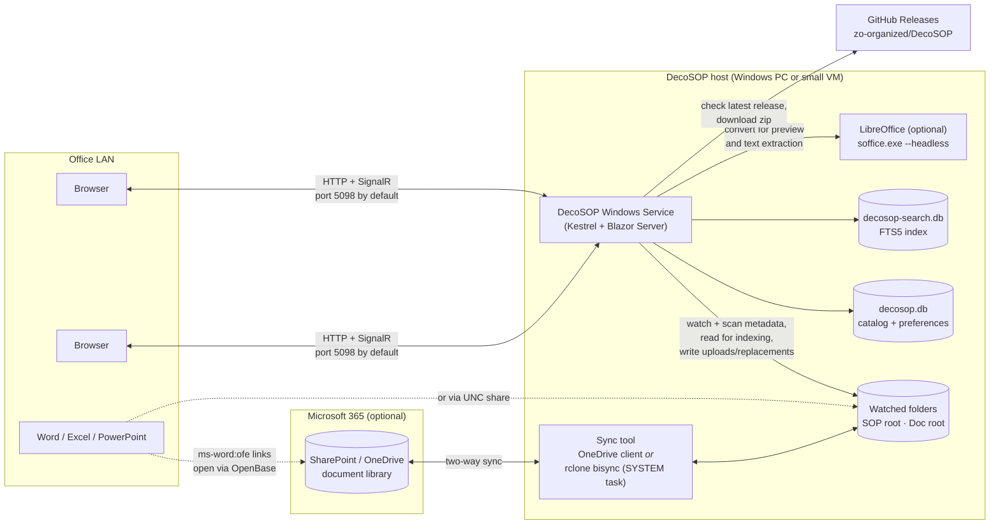
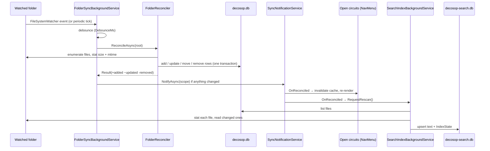
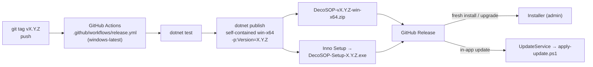

# System architecture

This document describes DecoSOP as a deployed system: the pieces that run, where they run, what
they talk to, and what state lives where. For the internal structure of the code, see
[code-architecture.md](code-architecture.md).

## Context



DecoSOP never talks to SharePoint or OneDrive itself. It only sees a **local folder**. Getting
cloud content into that folder is the job of a separate sync tool (the OneDrive desktop client,
or rclone configured by `installer/Configure-DecoSOP-Sync.ps1`), or the folder is simply a
network share or plain local directory.

## Runtime components

| Component | What it is | Notes |
|---|---|---|
| **DecoSOP service** | A self-contained `DecoSOP.exe` (win-x64, .NET 10) hosted with `UseWindowsService()` and registered as the `DecoSOP` Windows Service, auto-start. | Listens on `http://0.0.0.0:<port>`. Port comes from `port.config` (`PORT=nnnn`, written by the installer) or defaults to `5098`. No TLS, no authentication. |
| **Blazor Server UI** | All pages render server-side with interactive server render mode. Each browser tab holds a SignalR circuit to the service. | The browser only runs small JS helpers (`wwwroot/js/`) for PDF preview, printing, the context menu and sidebar resizing. |
| **File API** | Minimal-API endpoints under `/api/sops/{id}/…` and `/api/documents/{id}/…` (`download`, `preview`, `preview-pdf`) plus `/api/settings/export-db`. | Served straight from the watched folder, so a file must be physically present (OneDrive "Always keep on this device") to download or preview. |
| **Folder sync** | `FolderSyncBackgroundService`: a `FileSystemWatcher` per root (debounced, default 2 s) plus a periodic rescan (default 300 s, minimum 30 s). | Reads file *metadata* only, so it doesn't force OneDrive to download placeholder files. |
| **Search indexer** | `SearchIndexBackgroundService`: extracts text from changed files in batches of 40, with a pause between batches, and writes it to the FTS5 index. | A first build of a few thousand files takes ~15–25 min at low priority. Afterwards only changed files are re-read. |
| **LibreOffice** (optional) | `soffice.exe`, found in Program Files or on `PATH`. Run headless with a throwaway profile per launch. | Used for (1) Office → PDF previews, cached on disk, and (2) text extraction from `.doc`, `.rtf`, `.odt`, `.wps`, `.ppt`, `.pptx`, `.odp`. Without it those previews are unavailable and those file bodies are not searchable (titles still are). |
| **Updater** | `UpdateService`: polls the GitHub Releases API, downloads the release zip, and hands off to a generated PowerShell script that stops the service, copies files and restarts it. | Optional automatic install at a scheduled time of day. Settings in `update-config.json`. |
| **Sync tool** (external) | OneDrive desktop client (needs a signed-in session), or `rclone bisync` on a scheduled task running as SYSTEM (headless). | Configured by `Configure-DecoSOP-Sync.ps1`, which also writes the folder roots into `appsettings.Production.json` and restarts the service. |

## Request and data flows

### Browsing

1. A browser loads `/` and opens a Blazor circuit.
2. Pages read the category tree and files from `decosop.db` through a per-circuit cache
   (`DataCacheService`), overlaying the favorites, pins and colours for this client.
3. Opening a file goes to `/sops/{id}` or `/documents/{id}`. The viewer embeds
   `/api/{module}/{id}/preview` (PDFs, images) or `/api/{module}/{id}/preview-pdf`
   (Office files, converted by LibreOffice on first view and cached).

### A file changes in the folder



Changes made in the folder usually show up in the UI within a few seconds of landing on disk.
End-to-end delay from SharePoint also includes the sync tool's own interval.

### Writes from the UI

The UI can **create folders**, **rename folders**, **upload** new files and **replace** a file's
contents. All of these write to the watched folder first and then update the catalog row. The
sync tool then pushes the change upstream. **Deletion is deliberately not offered in the UI**:
files and folders are removed on disk, and the next reconcile removes them from the catalog.

### ONLINE binder

The sidebar's **LOCAL | ONLINE** switch selects between the folder-backed library (LOCAL) and
the ONLINE binder: pages written in the app's editor (TinyMCE 6, served from `wwwroot/lib`, so it
needs no internet access), organised into folders on a SOPs side and a Docs side. ONLINE pages
are stored in `decosop-online.db` on the server, not in the watched folders, so they don't
depend on the sync tool and **are not backed up by OneDrive**. Page HTML is sanitised on save and
on display, every save keeps the previous version, and a save that would overwrite someone
else's newer edit is stopped with a warning. ONLINE pages appear in search alongside LOCAL files.

### Search

The search box queries `decosop-search.db` directly (SQLite FTS5 with BM25 ranking). It does not
touch the watched folder or `decosop.db`. Results link back to `/sops/{id}` or `/documents/{id}`.

### Opening in Office

"Open in Word/Excel/PowerPoint" builds an `ms-word:ofe|u|<url>` style link. The URL is the
file's relative path appended to the module's configured `OpenBase` (a SharePoint/OneDrive URL
or a UNC share), so it points at a location the *client* can reach. When `OpenBase` is empty the
server's local path is used, which only works when the browser is on the host itself.

## State on disk

All paths are relative to the **data directory**: the install folder (`C:\DecoSOP` by default)
in production, or the project folder under `dotnet run` in Development.

| Path | Contents | Authoritative? | Across an installer upgrade | On uninstall |
|---|---|---|---|---|
| *Watched folders* (configured roots) | The actual SOPs and documents. | **Yes — the source of truth.** | Not touched | Not touched |
| `decosop.db` (+ `-wal`, `-shm`) | Category/file catalog (rebuildable from the folders) and per-client favorites, pins and colours (not rebuildable). | Only for preferences | Preserved | Kept |
| `decosop-online.db` (+ `-wal`, `-shm`) | The ONLINE binder: folders, pages written in the app, and their earlier versions. **Exists nowhere else** — not in OneDrive. Back it up with Settings → Export Online Binder. | **Yes** | Preserved | Kept |
| `decosop-search.db` (+ `-wal`, `-shm`) | FTS5 index and per-file extraction state. Purely derived. Deleting it causes a full rebuild on the next start. | No | Deleted → rebuilt | Deleted |
| `doc-uploads/previews/` | Cached PDF renderings of Office files, refreshed when the source is newer. | No | Preserved | Kept |
| `sop-uploads/`, `doc-uploads/` | Fallback storage when no root is configured for a module. | Yes, if used | Preserved | Kept |
| `appsettings.json` | Shipped defaults. | — | **Overwritten** | Deleted |
| `appsettings.Production.json` | `FolderSync` roots, `OpenBase` and `Enabled`, written by the sync tool. | Config | Preserved | Kept (deliberately) |
| `port.config` | `PORT=nnnn`, written by the installer for non-default ports. | Config | Re-written by the installer | Deleted |
| `update-config.json` | Updater settings (enabled, skipped version, auto-install time). | Config | Re-written by the installer | Deleted |
| `update-staging/` | Transient download/extract area for the in-app updater. | No | — | — |
| `rclone.exe`, `rclone.conf`, `rclone-bisync.ps1`, `sync/` | Headless sync tooling, credentials and the local mirror, if Method B is used. | Config | Preserved | Kept (deliberately) |

An installer upgrade runs the previous version's uninstaller silently, so anything listed under
`[UninstallDelete]` in `installer/DecoSOP.iss` is lost on *every upgrade* unless the installer
recreates it. That's why the sync configuration is deliberately left out of that list. The
uninstaller also removes the "DecoSOP Document Sync" scheduled task and the firewall rule.

> Put site-specific configuration in `appsettings.Production.json`, never in `appsettings.json`.
> The installer and the in-app updater both overwrite `appsettings.json`.

## Configuration

ASP.NET Core configuration, layered in the usual order: `appsettings.json` →
`appsettings.{Environment}.json` → environment variables → command line. The app-specific section
is:

```json
"FolderSync": {
  "Enabled": true,
  "PollIntervalSeconds": 300,
  "DebounceMs": 2000,
  "Sop": { "Root": "C:\\Docs\\SOPs",      "OpenBase": "" },
  "Doc": { "Root": "C:\\Docs\\Documents", "OpenBase": "" }
}
```

The roots are read **once at startup** (see `Program.cs`), so changing them requires a service
restart. The sync tool does this restart for you.

## Security model

DecoSOP is designed for a trusted office LAN holding non-sensitive content:

- **No authentication or authorisation.** Anyone who can reach the port can browse, download,
  upload, replace files and rename folders, and can download the whole catalog database via
  `/api/settings/export-db`.
- **Client identity is the remote IP address** (`ClientIdentityService`). It is used only to keep
  favorites, pins and colours per machine, and is not a security boundary.
- **Plain HTTP.** The installer opens the chosen port in Windows Firewall for inbound TCP.
- **ONLINE pages** are HTML written by anyone on the LAN and rendered for everyone else, so
  they're sanitised with HtmlSanitizer on save and again on display. Scripts, event handlers,
  iframes, forms and `javascript:` links are removed, and `data:` URIs are allowed only for
  images.
- **Upload safety:** uploads are capped at 50 MB, file names are sanitised, and a replacement must
  keep the original file extension. Replacements are written to a temp file and then swapped in
  atomically, so a sync client never picks up a half-written file.
- **Search snippets** come from document contents. They are HTML-encoded before highlight markers
  are added, so document text can't inject markup into the results page.
- The service account (LocalSystem by default) needs read/write access to the watched folders.

## Build, release and deployment



- **The version comes from the tag.** The release workflow passes `-p:Version` from the tag name,
  which overrides `<Version>` in `DecoSOP.csproj`. Keep the csproj version in step for local
  builds and for the updater's version comparison in development.
- **Installer** (`installer/DecoSOP.iss`): stops and re-registers the service, copies the publish
  output (excluding databases and upload folders), optionally writes `port.config`, optionally
  imports a database backup, optionally downloads and installs LibreOffice, adds the firewall
  rule, starts the service, and offers the Configure Document Sync tool. Upgrades preserve
  `decosop.db` and the sync configuration (see [State on disk](#state-on-disk)).
- **In-app updater** (`UpdateService`): checks
  `api.github.com/repos/zo-organized/DecoSOP/releases/latest` 30 s after startup and then every
  24 h. It compares the release tag with the running assembly version, downloads the zip
  asset into a unique `update-staging/<guid>/` folder, extracts it, and launches a detached
  `apply-update.ps1`. That script stops the service, waits for the exe to unlock, copies
  everything except a skip list (`decosop.db`, upload folders, `port.config`,
  `update-config.json`, `update-staging`), restarts the service and writes `update.log`.

## Operational characteristics

- **Single node, single process.** There is no clustering. SQLite runs in WAL mode with a 5 s busy
  timeout, so reads from user circuits don't block the background writers.
- **Degrades gracefully:** without LibreOffice, previews of Office files and the bodies of legacy
  formats are unavailable, but browsing and search by title still work. If a watcher can't be
  created (for example on some network shares), the periodic rescan still keeps things in sync. If
  the search index can't be opened, search is unavailable and everything else carries on.
- **Diagnostics:** `DecoSOP.exe extract-report "<folder>" [maxPerType]` runs the extraction
  pipeline over a folder without starting the web host and reports coverage per file type.
  **Settings** shows sync status (with a "Sync now" button), index coverage, failures and a
  "Rebuild index" action.
